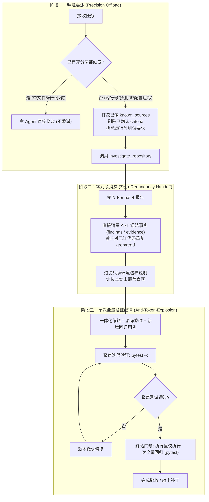

# CTOS 项目交接文档（v0.4 基线与后续候选进展）

交接日期 2026-11-03。工作区位于 `F:/CTOS`，Python 包名为 `trajectory-offload`。工作区根目录无 Git 元数据，历史已测版本以冻结清单中的运行时指纹定位。v0.7 和 v0.8 的实验及候选代码均已保留。

用户确认 **v0.4 继续作为版本优化的固定基线**。其冻结运行时指纹为 `16b105bfcc9e16fc0065bbda7b414c859aa39658684a25c5fb317b5d3f9e2d0b`，源码和发行包均已保留。v0.7 和 v0.8 是后续实验版本。原生主 Agent 直接执行的数据仍是评估卸载整体收益的对照。 [v0.4 冻结源码](../.trajectory/review-policy-optimization/frozen_v4/trajectory_offload) · [v0.4 Wheel](../dist/trajectory_offload-0.4.0-py3-none-any.whl)

当前工作区运行时代码、包元数据、锁文件、测试、基准脚本及调用 Skill 均已恢复到 v0.4.0。原有 v0.8 候选源码、测试、实验脚本、配置、Skill 和 README 保存在独立备份中。现有 MCP 会话需要重新连接或重启，才会加载恢复后的版本。 [候选备份](../.trajectory/workspace-restores/candidate-to-v04-20261103-181320-638ee804/manifest.json)

备份的 v0.8 候选曾修复状态判定：清洗只识别完整的只读环境说明，混合真实缺口保留，`triage` 保留原始 `partial` / `failed` 状态。这些是候选版本的能力。当前 v0.4 按其原有契约运行。

---

## 1. 项目目标与当前能力范围

Trajectory Subagent 是为长轨迹代码分析编排的专用执行器。主 Agent 通过 MCP 工具主动委派需要多步静态取证的局部任务，由专有 Skill 指导何时调用、如何传参以及消费结构化事实。

### MCP 工具矩阵
| MCP 工具 | 职责 | 当前输入与输出特性 |
| --- | --- | --- |
| `investigate_repository` | 只读定位、配置追踪、失败测试源码分析、静态变更影响分析 | MCP Format 3，使用 `known_evidence` 和证据引用表 |
| `verify_patch` | 在临时源码副本应用补丁并执行基线及回归检查 | 需要快照 ID；需配置 `execution-checks.json` 策略；返回 `verdict` 与退出阶段 |
| `diagnose_failure` | 按指定失败签名复现，结合执行记录和源码输出诊断 | 基于临时副本执行；保留因果不确定性 |
| `get_repository_state` | 获取源码快照 ID 与可用检查配置 | 零模型调用，轻量极速查询 |

### 核心设计与规程文档
- 基础系统架构：[系统设计](../TRAJECTORY_SUBAGENT_OFFLOADING_SYSTEM_V1.md)
- v0.7 发布与审计报告：[v0.7 发布报告](COMPILED_REPORT_V7.md)
- 主子 Agent 交互工作流规程：[v0.8 工作流规程](WORKFLOW_OPTIMIZATION_V8.md)
- Partial 精细化审计与消融报告：[Partial 审计与消融报告](PARTIAL_AUDIT_AND_ABLATION.md)

---

## 2. 本机接入、验证与 CLI 扩展

### 环境要求与模型配置
- Python 3.12+、uv、Git。
- 本地 OpenAI 兼容网关：`http://127.0.0.1:8788/v1`（`OPENAI_API_KEY = "local-dev"`）。
- 模型：`deepseek-v4.1-flash`，推理档位 `reasoning_effort = "low"`。

### 自动化测试套件
```powershell
Set-Location F:\CTOS
uv sync --locked
uv run --locked python -m unittest discover -s tests -q
```
恢复后的 v0.4 原版测试集共 61 项，全部通过。v0.8 候选此前的 92 项测试及其新增状态判定回归均保存在候选备份中。

### CLI 核心命令
```powershell
# 1. 运行只读代码库调查
uv run --locked trajectory-offload investigate --repo benchmarks/fixtures --task benchmarks/example-task.json --model deepseek-v4.1-flash --reasoning low --output .trajectory/handoff-smoke.json

```

`triage` 命令和交接消融脚本属于备份中的 v0.8 候选，需要在对应候选环境运行。
> [!NOTE]
> 调查命令退出码：`0` 表示 `completed`，`2` 表示 `partial` 或 `failed`，`1` 表示参数/配置错误。CLI 运行日志默认保存在 `%LOCALAPPDATA%/TrajectoryOffload/runs/`。

---

## 3. v0.8 候选的交互工作流记录

针对 v0.7 测试中的主 Agent 额外补查和重复全量测试，v0.8 候选曾制定以下三阶段规程。候选 Skill 已随源码保存在备份中，当前工作区使用 v0.4 Skill。 [候选 Skill](../.trajectory/workspace-restores/candidate-to-v04-20261103-181320-638ee804/previous/.agents/skills/repository-investigator/SKILL.md)



1. **阶段一（委派纪律）**：遇到跨文件/配置链路时立即委派，杜绝大范围本地游荡；`known_sources` 严格限制行号（≤260行），`remaining_criteria` 只勾选真缺口，严禁提出运行时执行类 criteria。
2. **阶段二（消费纪律）**：直接消费 Format 4 的 `findings`，严禁重复 `read`/`grep` 已证代码；识别只读系统披露不误判为代码盲区。
3. **阶段三（严格单次全量验证）**：
   - **绝对禁令**：严禁在编辑中途运行全量测试套件（如无参数的 `pytest tests/`）；
   - 源码修改与回归测试用例编写一体化同步完成；
   - 迭代调试仅运行聚焦测试（`pytest -k <test_name>`）；
   - 聚焦测试全部通过后，执行且仅执行**唯一一次**全量测试回归作为最终门禁。

---

## 4. Partial 判定精细化审计与消融实验结论

### 1. 17 项验收 Criteria 与 15 个未决问题审计
- **验收项 (Acceptance Criteria)**：
  - 11 项被标记为 `unresolved` 的 criteria 中，**仅 36.4%（4 项）为真实代码盲区**；
  - **63.6%（7 项）属于虚假未决（False Unresolved）**：45.5% 是因为模型过度保守不敢下结论，18.2% 是因为验收项要求了只读工具无法执行的运行时测试验证。
- **未决问题 (Unresolved Questions)**：
  - **26.7% 为纯粹的只读环境免责声明**（如 `"Tests were not executed"`、`"The fix itself is not applied"`），被系统误计入未决缺口。

### 2. 交接消融实验实测数据 (Handoff Ablation)
在 `benchmarks/fixtures` 上真实调用本机 `deepseek-v4.1-flash` 的 4 组消融对照数据：

| 实验组 | 状态 | 总 Token | 输入 Token | 缓存输入 | 输出 Token | 事实条目 (Findings) | 耗时 |
| :--- | :---: | :---: | :---: | :---: | :---: | :---: | :---: |
| **`full_handoff` (完整交接)** | `partial` | **14,626** | **13,314** | **6,656** | 1,312 | **8** | 13.45s |
| **`no_known_sources` (无已知源码)** | `partial` | 15,479 | 14,284 | 6,784 | 1,195 | 16 | 8.73s |
| **`blanket_criteria` (无项过滤)** | `partial` | 14,856 | 13,539 | 5,888 | 1,317 | 15 | 9.84s |
| **`zero_handoff` (零交接冷启动基线)** | `partial` | 15,134 | 14,001 | 5,632 | 1,133 | 16 | 10.32s |

- **`known_sources` 的量化价值**：杜绝了入口代码的二次搜索，输入 Token 减少 6.8%，事实条目从 16 个压缩至 8 个（**减少 50%**）。
- **`remaining_criteria` 的量化价值**：聚焦分析重点，防止未决问题在已解决项上发散蔓延（未决问题从 4 个控制至 2 个）。
- **完整交接实现全局最低 Token**。

---

## 5. v0.8 候选的代码演进记录

### 1. 核心模块与新增能力
| 模块路径 | 职责与本次更新 |
| --- | --- |
| [facts.py](../.trajectory/workspace-restores/candidate-to-v04-20261103-181320-638ee804/previous/src/trajectory_offload/facts.py) | 识别独立只读说明并保留混合未决问题，对明确的运行验收要求保持未完成状态 |
| [cli.py](../.trajectory/workspace-restores/candidate-to-v04-20261103-181320-638ee804/previous/src/trajectory_offload/cli.py) | `triage` 汇总 Format 4 报告，并结合原始状态、验收覆盖和验证结果输出建议 |
| [runtime.py](../.trajectory/workspace-restores/candidate-to-v04-20261103-181320-638ee804/previous/src/trajectory_offload/runtime.py) | 调查运行时编排、快照捕获、上下文构造、最多两轮取证与预算管控 |
| [contracts.py](../.trajectory/workspace-restores/candidate-to-v04-20261103-181320-638ee804/previous/src/trajectory_offload/contracts.py) | `known_sources`、`remaining_criteria` 契约约束与 Pydantic 校验 |
| [execution.py](../.trajectory/workspace-restores/candidate-to-v04-20261103-181320-638ee804/previous/src/trajectory_offload/execution.py) 与 [patching.py](../.trajectory/workspace-restores/candidate-to-v04-20261103-181320-638ee804/previous/src/trajectory_offload/patching.py) | 隔离临时副本执行、补丁应用与故障诊断 |
| [test_compiled_report.py](../.trajectory/workspace-restores/candidate-to-v04-20261103-181320-638ee804/previous/tests/test_compiled_report.py) | 覆盖混合未决、执行验收、静态失败测试定位，以及 Triage 对原始状态、验收覆盖和验证结果的处理 |

### 2. 版本与运行时指纹对比
- **v0.7.0 已冻结实验版本运行时指纹**：
  `c1f757e65508dcd7fb31413d906754a9a29f750eda07168b38b661f216d6bd1a`
- **状态判定修复前的 v0.8.0-Candidate 指纹**：
  `5c53f4e1815f433af0bad015c755e944676cb4a857b87aac58c12decb80f6864`
- **备份中状态判定修复后的候选版本指纹**：
  `e9b8211e7c1d5b98945a41c8e579b312cab6e3348e691113056bafbc687d57da`

已记录的交接消融结果对应修复前的候选版本。修复后的一轮 DSH 复测中，三次因主 Agent 收到空响应而未触发卸载，相关请求输入 Token 记为 0。另一次完成卸载并通过最终验收，但总用量为 513,126 Token、耗时 208.5 秒，超过 500,000 Token 预算。其同任务的原始 v0.4 记录为 377,615 Token、157.172 秒，独立验收通过。四次尝试不能用于计算可靠的候选组平均收益。 [本轮冻结清单](../.trajectory/v8-evaluation/dsh-retest/manifest.json) · [v0.4 同任务记录](../.trajectory/review-policy-optimization/dsh-v4/offload/runs/default-map-none-impact-r0-offload/result.json) · [候选同任务记录](../.trajectory/v8-evaluation/dsh-retest/candidate/runs/default-map-none-impact-r0-offload/result.json)

---

## 6. 后续工作路线图 (Next Steps)

1. **全新盲测任务上的主动委派泛化验证**：
   使用未参与过系统开发的全新任务（如 `benchmarks/tasks.json` 中的 `implementation-localization` 与 `failing-test-localization`），验证主 Agent 在完全自主状态下的卸载触发时机与整体表现。
2. **端到端新候选基准复测 (v0.8 vs v0.7 vs Native)**：
   在独立目录（如 `.trajectory/v8-evaluation/`）中冻结新的源码与驱动，按照 DSH 实验规程对比运行特调卸载臂，量化单次全量验证纪律与免责声明清洗引擎对端到端延迟与 Token 的压降幅度。
3. **复合 Criteria 自动拆分指导**：
   优化主 Agent 任务构造，指导主 Agent 提出单一职责的原子 criteria，避免因复合项中单个断言未见导致整体被判未决。
