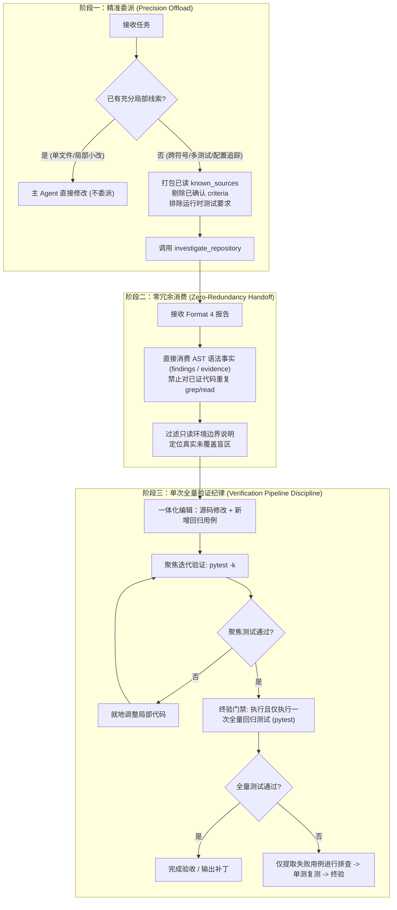

# CTOS 主子 Agent 交互工作流优化规程 (v0.8 候选规范)

交接文档 ([docs/HANDOFF_V7.md](file:///f:/CTOS/docs/HANDOFF_V7.md)) 明确指出：v0.7 最终版虽达成了 100% 验收通过率并减少了 15.3% 的总 Token，但端到端延迟仍比原生高 21.4%，且调查普遍报告 `partial`。在 `env-prefix-impact-r1` 样本中，由于中途插入全量测试，主 Agent 消耗了 490,863 Token 和 20 次模型回合。

本规程针对上述瓶颈进行系统性工作流重构，规范主子 Agent 的委派、消费与验证纪律。

---

## 1. 深度复盘：核心瓶颈与问题归因

### 瓶颈 1：委派端（Main Agent -> Subagent）的前期漫游与 Criteria 越界
- **无序预查**：主 Agent 在委派前常执行 `glob`、`read`、`grep` 等 4~6 次连续命令。
- **线索沉淀不足**：已读取的代码未完整填入 `known_sources`，或将已观察代码的验收问题依然标记为 `remaining_criteria: [0, 1, 2, ...]`。
- **提出越界需求**：在静态 `acceptance_criteria` 中要求“验证测试运行通过”，迫使只读子 Agent 必须判定为 `unresolved`。

### 瓶颈 2：汇报端（Subagent -> Main Agent）的过度保守
- 审查子 Agent 运行记录发现，`unresolved_questions` 中大量充斥系统常识性只读限制（如：`"Tests were not executed; pass/fail status is inferred only from source predicates"`、`"The fix itself is not applied (read-only investigation)"`）。
- 这种系统性边界并非代码逻辑缺陷，却导致 `status` 始终降级为 `partial`，进而引发主 Agent 误判并产生惊慌。

### 瓶颈 3：消费与验证端（Main Agent Post-Handoff）—— 灾难性的多轮全量测试循环
在 `env-prefix-impact-r1` 中，执行序列为：
1. 主 Agent 编辑 `core.py`；
2. 运行单用例测试通过；
3. **立刻运行全量测试套件（`pytest tests/`）**：数千字符的测试通过/进度信息永久写入上下文；
4. 编写新增回归测试 `tests/test_envvar_hyphen.py`；
5. 运行新用例失败；排查后再次编辑 `core.py`；
6. 运行新用例通过；
7. **再次运行全量测试套件（`pytest tests/`）**：全套测试日志二次累加。
- **后果**：上下文严重膨胀，Cached Input 飙升至 438,656 tokens，总 Token 达 490,863，耗时超 200 秒。

---

## 2. 优化后的标准化三阶段交互协议 (Three-Phase Protocol)

### 规程细节

#### 阶段一：精准委派规程
1. **停止无谓漫游**：一旦明确需要跨文件追踪（例如涉及命令行解析、环境变量前缀、配置继承），在获得初始入口符号后立即调用 `investigate_repository`。
2. **约束契约数据**：
   - `known_sources` 必须传入已读范围（严格控制在 ≤ 260 行、16,000 字符内）；
   - `remaining_criteria` 仅标记尚未掌握证据的问题索引；
   - 严禁在静态 criteria 中要求“测试运行结果”。

#### 阶段二：零冗余消费规程
1. **事实优先信任**：MCP Format 4 返回的 `findings` 均通过 AST 机械检查。主 Agent 必须直接采用其给出的语法结论和引用，**严禁对已核实的文件发起重复的 `grep` 或 `read`**。
2. **正确解读 `partial`**：
   - 若 `unresolved_questions` 仅说明“未在运行时执行测试”或“补丁未应用”，主 Agent 应将其视为只读常识说明，只要静态代码依据充分，即可直接进入修复阶段。
   - 只有当报告指出具体代码段未找到或存在语法分支未知时，才进行极窄范围的针对性补查。

#### 阶段三：严格单次全量验证纪律（抗 Token 爆炸核心）
1. **严禁中途全量测试**：在源码编辑、测试用例编写尚未全部就绪前，**严禁运行全量测试套件（如无参数的 `pytest tests/` 或 `python -m unittest`）**。
2. **源码与测试一体化**：先同步完成生产代码修改与测试用例文件的新增/更新。
3. **极窄聚焦单测**：调试迭代期间，只允许运行目标单一测试（如 `pytest tests/test_basic.py -k test_envvar`）。
4. **终验单次门禁**：仅在所有聚焦测试通过后，触发**唯一一次**全量测试回归。若有偶发失败，仅针对失败用例单独排查，严禁连续多次运行全量测试。

---

## 3. 规范文件落地与维护

1. **主 Agent Skill**：已同步更新至 [`.agents/skills/repository-investigator/SKILL.md`](file:///f:/CTOS/.agents/skills/repository-investigator/SKILL.md)，以明确的条款形式指导主 Agent。
2. **后续复测配置**：在开展下一阶段消融与 benchmark 评估时，新候选组应在独立目录（如 `.trajectory/workflow-optimization/`）中运行，保持原有基线数据与指纹不变。
